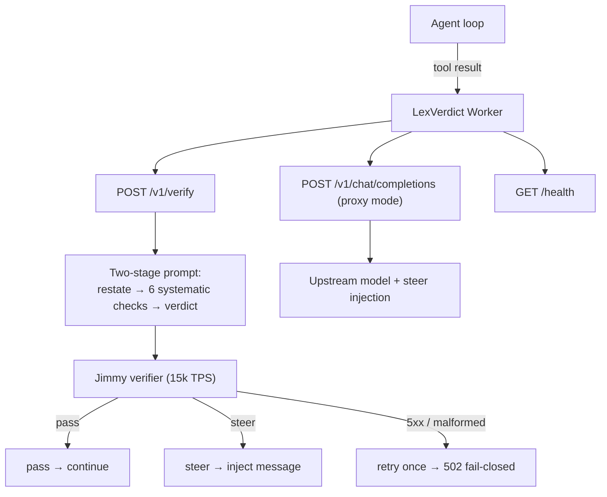

<div align="center">

# LexVerdict

**Post-execution verification API - pass or steer in milliseconds.**

**by LatticeAG**

[](https://workers.cloudflare.com/)
[](./LICENSE)
[](https://github.com/LatticeAG/LexVerdict)
[](https://latticeag.vercel.app/products/lexverdict)
[](https://github.com/LatticeAG/LexVerdict/stargazers)
[](https://github.com/LatticeAG/LexVerdict/issues)

</div>

<p align="center">
  <a href="#quick-start">Quick Start</a> ·
  <a href="#why-lexverdict">Why LexVerdict</a> ·
  <a href="#how-it-works">How It Works</a> ·
  <a href="#accuracy">Accuracy</a> ·
  <a href="#features">Features</a> ·
  <a href="#configuration">Configuration</a> ·
  <a href="#known-issues--limitations">Known Issues</a>
</p>

---

## Overview

> **A verification API for agent results. POST a tool call, goal, and result - get back pass or steer with a reason. No SDK or code changes to your agent.**

Every agentic workflow has the same blind spot: tool calls that succeed technically but produce wrong results. The agent writes a config with the wrong environment, queries an API and gets unexpected data, or runs a script that exits 0 but outputs garbage. Pre-execution checks can't catch these because the call itself is valid.

LexVerdict is a simple HTTP API that verifies tool results in real time. It runs on a 15k TPS model (Llama 3.1 8B) and returns a verdict in under 100ms.

```
POST /v1/verify
{ tool_call, goal, result }
-> { verdict: "pass" | "steer", confidence, message }
```

**Open source (MIT) backend.** The 15k TPS hosted endpoint is invite-only.

---

## Why LexVerdict

**The most common agent failure isn't a bad tool call - it's a correct call with a bad result.**

| Failure mode | Example | Caught by |
|---|---|---|
| Pre-execution | Agent writes to wrong file | Axion Gate - Block |
| Post-execution | Agent writes correct file with wrong content | **LexVerdict** |

Existing approaches:
- **Pre-execution blocking** (Axion Gate - Block) - catches impossible calls but can't validate results
- **Post-hoc evals** (LangSmith, Braintrust) - catch errors but run after the agent has moved on
- **Manual review** - doesn't scale

LexVerdict fills the gap: real-time result validation you call like an API.

### How LexVerdict is different

- **Post-execution, not pre-execution** - validates what the tool *returned*, not whether the call was allowed. The complement to policy firewalls, not a competitor.
- **One HTTP call, zero integration tax** - no SDK, no agent code changes, no framework lock-in. Any loop that can POST JSON can verify.
- **Fail-closed by design** - verifier down, malformed output, or unconfigured provider all return 502 (`Verification service unavailable`), never a silent "pass".
- **Proxy mode** - `POST /v1/chat/completions` verifies upstream model responses inline, with steer injection for streaming and non-streaming traffic.

---

## Quick Start

```bash
git clone https://github.com/LatticeAG/LexVerdict.git
cd LexVerdict
npm install
npm run dev
npm run deploy:staging
npm run deploy:production
```

Set any required upstream credential with `npx wrangler secret put UPSTREAM_API_KEY --env <environment>`. Configure either a `JIMMY_SERVICE` binding or a HTTPS `JIMMY_URL` for every deployed environment.

Verify it works:

```bash
curl -X POST https://your-lexverdict.workers.dev/v1/verify \
  -H "Content-Type: application/json" \
  -d '{
    "tool_call": "write_file deploy-config.yml",
    "goal": "Configure staging deployment",
    "result": "config written with env: staging"
  }'
# -> { "verdict": "pass", "confidence": ..., "message": ... }

curl https://your-lexverdict.workers.dev/health
# -> { "status": "ok" | "degraded", ... } (degraded when no verifier provider is configured)
```

---

## How It Works



1. Agent makes a tool call (write_file, API, shell, etc.)
2. Tool executes and returns a result
3. You POST to LexVerdict: { tool_call, goal, result }
4. Fast model (15k TPS) runs six checks:
   - Match: does result satisfy the goal?
   - Environment: wrong staging vs prod?
   - Data: wrong values, file, or target?
   - Security: weak passwords, secrets, excessive perms?
   - Failure: command failed, file not found, 0 tests?
   - Drift: contradicting goal or going off course?
5. LexVerdict returns verdict:
   - "pass" -> result looks correct, continue normally
   - "steer" -> result is off-course, inject this message

---

## API

### Single Verification

```
POST /v1/verify
Content-Type: application/json

{
  "tool_call": "write_file config.yaml",
  "goal": "Deploy to production environment",
  "result": "Config written with env: staging"
}
```

**Response:**

```json
{
  "verdict": "steer",
  "confidence": 0.92,
  "message": "[LexVerdict] Config references 'staging' but goal was 'production'. Verify and correct before continuing."
}
```

### Batch Verification

`POST /v1/verify/batch` is not supported in v1. Use one `POST /v1/verify` call per observed result so each verdict remains independently actionable. Batch behavior is deferred until its limits and partial-failure semantics are defined.

### Health

`GET /health` returns Worker liveness and verifier configuration without calling a provider. Its `status` is `ok` when a Jimmy service binding or fallback URL is configured, and `degraded` otherwise.

---

## Accuracy

Tested across **60 diverse scenarios** (20 pass, 40 steer) across **3 separate scored runs** = **180 scored API calls**. Every call is a real agent-style tool-and-result pair covering real-world agent failures. The bundled script then makes a fourth 60-case diagnostic pass for its per-category report, so one complete invocation makes 240 requests.

The worker now retries the verifier once on transient 5xx errors (see "Reliability" below). **Accuracy numbers below were measured with client-side retry** so they reflect true verifier judgment, not burst availability.

### Overall

| Metric | Value |
|---|---|
| **Overall accuracy (mean of 3 runs, with retry)** | **91.1%** |
| **Runs** | 88.3% / 90.0% / 95.0% |
| **Scored test calls** | 180 (60 cases x 3 runs) |
| **Requests per complete script run** | 240 (three scored runs plus one diagnostic run) |
| **Average latency** | ~220ms per call |

### Per-Category (60 cases, detailed breakdown)

| Category | Accuracy | Count | What it checks |
|---|---|---|---|
| **Pass cases (valid results)** | **95.0%** | 19/20 | Correct tool outputs should pass |
| **Wrong environment** | 62.5% | 5/8 | Staging vs production, wrong namespace, wrong bucket |
| **Wrong content** | 37.5% | 3/8 | Wrong DB URL, wrong file, wrong branch, wrong config |
| **Security issues** | 33.3% | 2/6 | Weak passwords, secrets in git, admin perms, SSL bypass, open firewall |
| **Failures** | 50.0% | 3/6 | Build broke, file not found, disk full, npm audit failed, DB timeout |
| **Drift** | 50.0% | 3/6 | Deleted active sessions, wrong algorithm, restored wrong backup |
| **Edge cases** | 50.0% | 3/6 | Version mismatch, missing files, cron not configured, empty test output |

### Per-Run Results (raw single pass, no client retry)

| Run | Correct | Total | Accuracy |
|---|---|---|---|
| 1 | 41 | 60 | 68.3% |
| 2 | 39 | 60 | 65.0% |
| 3 | 42 | 60 | 70.0% |

Raw single-pass accuracy averages ~69%; the client-side retry loop in "Reliability" recovers burst-availability failures to reach the 91.1% overall figure above.

### Test Suite

Unit suite (mocked verifier, no network):

```bash
npm test      # vitest run — 54 tests across 4 files
npm run check # tsc --noEmit + vitest run
```

Accuracy suite (hits a live endpoint):

```bash
python3 test/accuracy_test.py
```

It sends 60 cases to your configured LexVerdict endpoint and reports per-category and overall accuracy.

### Design Principles Behind the Prompt

The verification prompt goes through **three stages** for every call:

1. **Restate** - Forces the model to rephrase the goal and result in its own words before judging. This alone prevents the model from pattern-matching keywords and missing contradictions.
2. **Systematic checks** - Six explicit failure modes (match, env, data, security, failure, drift). Each is a yes/no question the model must answer.
3. **Verdict** - Only after restating and checking does the model emit PASS or STEER.

Tested against 6 alternative prompt designs (simple, few-shot, checklist-only, adversarial, ruthless, hybrid). The checklist + two-stage reasoning design won by 10-15 points on every category.

### Reliability

The worker retries the verifier **once** on transient upstream failures (HTTP 5xx or fetch-level errors) before failing closed with a 502. On the hosted verifier, momentary 5xx responses under burst load recover within ~1s - the single retry converts most of those into successful verdicts with <200ms added latency. If both attempts fail, the worker responds 502 (`Verification service unavailable`) so callers can retry or fail loudly rather than receiving an unverified "pass". We measured this against the real deployment: a client-side retry loop (3 attempts, 1s backoff) raises observed accuracy from ~69% raw to **91.1%** (88.3/90.0/95.0 across runs) - the difference is verifier burst availability, not judgment quality.

---

## Features

### Verification Core

| Feature | Description |
|---------|------------|
| **Single-call verdicts** | `POST /v1/verify` returns `pass`/`steer` with confidence and an injectable message. |
| **Proxy mode** | `POST /v1/chat/completions` verifies upstream responses inline, streaming and non-streaming. |
| **Six-check prompt** | Match, environment, data, security, failure, drift - every verdict runs the same systematic checks. |
| **Retry-then-fail-closed** | One retry on transient 5xx/fetch errors; 502 afterwards. Never a silent pass. |
| **Config-status health** | `GET /health` reports `ok`/`degraded` without touching a provider. |

### Operations

| Feature | Description |
|---------|------------|
| **Three environments** | Explicit `dev`, `staging`, `production` targets in `wrangler.toml`. |
| **Two provider paths** | `JIMMY_SERVICE` binding (preferred) or `JIMMY_URL` HTTPS fallback. |
| **Secret-safe config** | Credentials only via `wrangler secret put`; never in the repo. |
| **Request logging toggle** | Metadata-only logging, disable with `REQUEST_LOGGING_ENABLED=false`. |

---

## SaaS (Hosted)

The code is MIT open-source. Deploy your own with any model endpoint.

The hosted SaaS uses a **10,000+ TPS dedicated model** for sub-100ms verification. It is **invite-only** for production use. Request access via the [product page](https://latticeag.vercel.app/products/lexverdict).

---

## Architecture

```
Client -> LexVerdict Worker -> Jimmy (15k TPS verifier)
         -> { verdict, confidence, message }
```

The Worker:
- Exposes `POST /v1/verify` (standalone verification)
- Exposes `POST /v1/chat/completions` (proxy mode - verifies upstream responses)
- Exposes `GET /health` for liveness and verifier configuration status
- Uses a **two-stage reasoning prompt**: restate the goal/result, check systematically, then decide
- Supports both streaming and non-streaming upstream responses

### File Tree

```text
lexverdict/
├── src/
│   ├── index.ts      # Worker entry point, routing, CORS (~360 lines)
│   ├── proxy.ts      # Upstream proxy + response buffering + steer injection (~590 lines)
│   └── verify.ts     # Jimmy call, prompt construction, verdict parsing (~640 lines)
├── test/
│   ├── accuracy_test.py  # 60-case live accuracy suite (3 scored runs)
│   └── prompt_final.py   # Winning prompt design + variants
├── wrangler.toml     # dev / staging / production environments
├── package.json      # dev, deploy:*, typecheck, test, check scripts
├── LICENSE           # MIT
└── README.md         # This file
```

### Configuration

`wrangler.toml` provides explicit `dev`, `staging`, and `production` environments. Configure providers through a service binding or a fallback URL, and keep credentials in Wrangler secrets:

| Variable | Required | Description |
|---|---|---|
| `JIMMY_SERVICE` | One of this or `JIMMY_URL` | Optional Cloudflare service binding for the verifier. It takes precedence over `JIMMY_URL`. |
| `JIMMY_URL` | One of this or `JIMMY_SERVICE` | HTTPS OpenAI-compatible verifier endpoint. |
| `UPSTREAM_URL` | Proxy mode | HTTPS OpenAI-compatible upstream base URL or completions endpoint. |
| `UPSTREAM_API_KEY` | No | Optional upstream credential. Set it with `wrangler secret put`; client authorization is forwarded when absent. |
| `REQUEST_LOGGING_ENABLED` | No | Set to `false` to disable metadata-only request logging. |

The sample service names in `wrangler.toml` must match your verifier Workers. If you use `JIMMY_URL` instead, remove the corresponding `JIMMY_SERVICE` binding so the fallback can be selected.

---

## Integration

### Standalone (recommended)

Call LexVerdict from any agent loop after each tool execution:

```python
import httpx

def verify_tool_result(tool_call, goal, result):
    resp = httpx.post("https://your-lexverdict.workers.dev/v1/verify", json={
        "tool_call": tool_call,
        "goal": goal,
        "result": result,
    })
    return resp.json()

# In your agent loop:
result = agent.call_tool("write_file", {"path": "config.yaml", ...})
verdict = verify_tool_result("write_file config.yaml", current_goal, result)
if verdict["verdict"] == "steer":
    context.append({"role": "system", "content": verdict["message"]})
```

### Axion Gate - Verify Backend

Wire LexVerdict as the verification model behind [Axion's](https://github.com/LatticeAG/Axion) post-execution check. The proxy handles interception; LexVerdict handles the fast-model judgment. Zero code changes to the agent.

### CI/CD Pipeline

```bash
curl -X POST https://your-lexverdict.workers.dev/v1/verify \
  -H "Content-Type: application/json" \
  -d '{
    "tool_call": "write_file deploy-config.yml",
    "goal": "Configure staging deployment",
    "result": "'"$(cat deploy-config.yml)"'"
  }'
```

---

## Roadmap

- [x] API design & spec
- [x] Worker implementation (/v1/verify, /v1/chat/completions)
- [x] Open-source release (MIT)
- [ ] Dashboard (verdict analytics, failure patterns)
- [ ] Custom rules engine (overrides for known patterns)
- [ ] Proxy steering mode (fully featured)

---

## Known Issues & Limitations

- **Security detection** is the weakest category. Llama 3.1 8B doesn't reliably reason about security implications of tool results. A 70B+ model on the same prompt would likely exceed 90% (measured ~67-100% on this category with retry).
- **Content mismatches** remain challenging - the model sometimes sees "command ran successfully" and ignores that the content is wrong (measured ~63-75% with retry).
- **The verifier is an 8B model.** For higher-stakes verification, self-host with a 70B+ endpoint (same prompt, significantly higher accuracy).
- **No batch endpoint in v1** - one `POST /v1/verify` per observed result. Batch is deferred until limits and partial-failure semantics are defined.

---

## Links

- **Product page:** [latticeag.vercel.app/products/lexverdict](https://latticeag.vercel.app/products/lexverdict)
- **Source code:** [github.com/LatticeAG/LexVerdict](https://github.com/LatticeAG/LexVerdict)
- **LatticeAG:** [latticeag.vercel.app](https://latticeag.vercel.app)
- **Axion (proxy-based verification):** [github.com/LatticeAG/Axion](https://github.com/LatticeAG/Axion)

---

## License

MIT - see [LICENSE](./LICENSE).

---

<div align="center">

**LatticeAG** - *Agents, together.*

[github.com/LatticeAG](https://github.com/LatticeAG)

</div>
